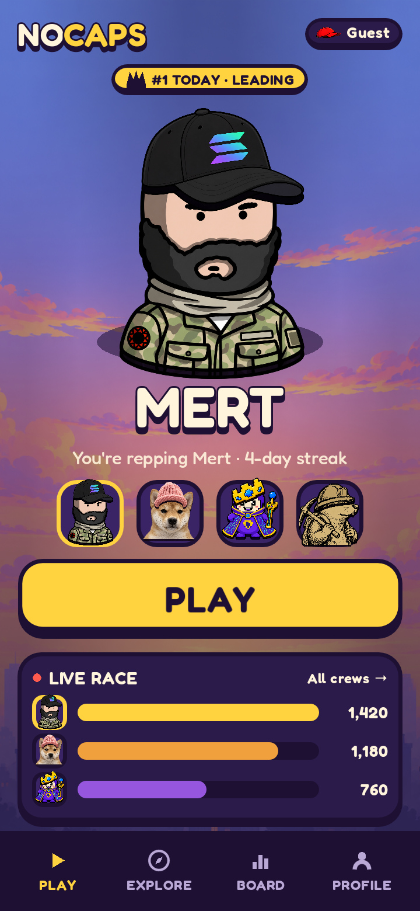
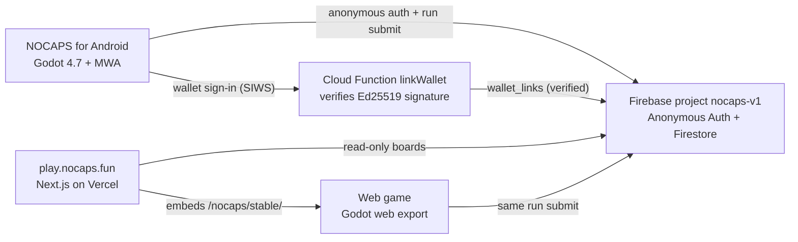

# NOCAPS

**Turns crypto communities into teams.** Every tap is a point for your crew, and crews battle live —
on Seeker and on the big screen at their events.

NOCAPS is a portrait, one-tap, Android/Seeker-first game built with Godot 4. Pick the community you
represent, fly a cap, and land cleanly on your own mascot to score and keep the combo alive. Your score
becomes contribution for your crew on the live daily and weekly boards.

> **Read. Tap. Land. Bounce. Contribute. Replay.**



Early Beta. Scores may reset. Built for the Solana Mobile **CLOCK IN** hackathon.

## Install the APK

[**Download NOCAPS for Android (APK)**](https://github.com/S1r1u511/nocaps/releases/latest/download/nocaps.apk)

- Android 7.0+ (API 24). Package: `com.nocapsfun.game`.
- First screen in about 3 s on a mid-range Android phone (measured on 1.0.0).

## How to play

- **Tap anywhere** to flap the cap upward; you steer by timing your taps.
- **Land on the head of your own crew's mascot** to score and bounce straight back up. A centered
  (*perfect*) landing scores `5 × multiplier`; landing near the edge scores `2 × multiplier`.
- **Keep a combo** for an escalating multiplier: `×1 → ×2 → ×3 → ×4` at 0 / 5 / 10 / 20 consecutive
  landings. Landing on a mascot's **body** is a **Bump**: `+1` flat and the combo resets.
- **Touching a rival mascot, a hazard, or the ground ends the run.** Hazards start after ~5 s
  (spike ball, buzzsaw, storm cloud, and a ceiling spike if you hug the top too long).
- Coins are collectible currency only — they never add score or contribution.
- Every run is one endless attempt; retry is immediate. Your contribution is `run score × streak`.

## Today's Clash and crew battles

- **Crew battles (shipped):** the app finds a live battle on its own (a `tournaments` document with
  `status == live`), shows the battle title, clock and crew points on Home, and stamps each result
  with "Counts in …". Runs that finish inside the window add to that crew's battle board, and the
  standalone web game does the same.
- **Today's Clash (shipped):** the day's top two crews on the daily board are featured as *today's
  clash*, shown on Android and on play.nocaps.fun from the same daily data (no new backend, no
  scheduler). A live, admin-started battle takes over whenever one is running.

## How the live boards stay honest

- **The server's clock owns the day.** Daily (UTC) and weekly (ISO) boards accept a write only for the
  current server period; the phone's clock never decides where a run counts.
- **Offline play is safe.** Runs are queued on the phone (up to 500, safely written) and sent when the
  connection is back. A run counts on the boards if it syncs the same server day it was played;
  later than that, it is kept as a personal score. The result screen always says which.
- **Every board point comes from a real run.** One atomic commit creates an immutable run and the
  board increments together; the rules reject any increment that doesn't match the run (per-run cap,
  plausibility vs. duration, 2 s rate limit, player-name format).
- **Wallets are verified by the server**, never trusted from the client (see Solana below).
- **Versioned:** the app reads a `config/app` document at launch and asks for an update when it's
  below the minimum version, so backend changes never break old installs silently.
- **No polling:** screens fetch when opened, after a run and on resume; timers run only during a
  live battle.

## Architecture

Godot clients write runs to Firestore under strict rules; one Cloud Function verifies wallet
sign-ins; the web platform only reads.



- **Game** (this repo) — Godot 4.7 native Android build *and* the web export embedded by the
  platform.
- **Backend** — Firebase project `nocaps-v1`: anonymous auth + Firestore over REST. One atomic commit
  per run writes an immutable `runs/{runId}` and a bounded community leaderboard increment, under
  `backend/firestore.rules`. One Cloud Function (`linkWallet`, `backend/functions`) verifies wallet
  sign-ins. Dev and preview builds use a separate `nocaps-dev` project.
- **Platform** (separate repo) — the Next.js hub at **play.nocaps.fun**: home, explore, crew
  pages, live board, caps, rewards, results, Arena TV, and the `/play` embed. It reads Firestore and
  owns crew requests; it does not write runs.

## Solana

Wallet identity uses **Mobile Wallet Adapter (MWA 2.0) Sign-In-With-Solana** (mainnet, read-only), isolated behind
`platform/wallet_service.gd` and the Godot ↔ Kotlin bridge so gameplay never touches MWA code.

- **Read-only by design.** The wallet only signs in (SIWS), signs a human-readable message, or
  disconnects. It is never asked to sign or send a transaction, approve a transfer, or blind-sign.
- **Why the wallet matters:** connecting a wallet makes you **prize-eligible** — the sign-in links the
  wallet to your anonymous player on the prize board — and lets **crew titles** appear beside
  wallet-verified players. Playing and scoring stay free and anonymous; only prizes need a wallet.
- **Verified on the server.** One wallet approval returns the signed SIWS message. The `linkWallet`
  Cloud Function checks the Ed25519 signature, that the message names this player
  (`nocaps:player:<uid>`) and this address, the nocaps.fun domain, and that it was issued within
  15 minutes; only then is `wallet_links/{uid}` written (`verified: true`). Clients can't write it.

## Build and test

Requires **Godot 4.7**. The first run imports the project.

```bash
# Import once (new checkout), then run the merge gate:
"$GODOT" --headless --path . --import
scripts/run_tests.sh                 # all offline smoke tests, fresh temp user:// each
scripts/run_tests.sh run_core_smoke  # one or more named tests
GODOT=/path/to/Godot scripts/run_tests.sh
```

`scripts/run_tests.sh` is the merge gate: 22 offline smoke tests (core loop, feel, coins, screens,
submission, community, wallet link, battles, quests, race, embed …) and it fails on any
`SCRIPT ERROR`. Backend tests:

```bash
cd backend/tests && npm install && npm test        # Firestore rules (emulator, needs Java)
cd backend/functions && npm install && npm test    # linkWallet signature verification
```

Android export presets are **Android** (release, live project), **Android Dev** and **Android
Preview** (`nocaps_dev` feature: DEV panel + the `nocaps-dev` Firebase project), **Android
Side-by-Side** and **Web** (live project). `scripts/build_release.sh` builds and verifies the
release-signed APK; `scripts/deploy_web.sh` publishes the web build to Firebase Hosting.

## Repo map

```text
core/         app flow, save, sound, links
gameplay/     run, cap, spawn, difficulty, landing, hazards, mascot, coins
communities/  community + mascot definitions, repository
meta/         profile, run submission, standings, scoring, quests, race
platform/     backend client, battle service, wallet (MWA), embed service
ui/           home/explore/community/board/profile/quests/HUD/result kit
data/         authored communities, caps, backgrounds, tuning
scenes/       main shell, run scene, UI scenes
tests/        headless rule + scene smoke tests
backend/      Firestore rules/indexes + rules tests, linkWallet Cloud Function + tests
scripts/      release, build_release, deploy_web, run_tests, capture_screens
web/          shell.html + game_bridge.js (web host page and embed bridge)
```

## Roadmap

Next, in rough order, after the submission build:

- **Coins and shop** — spend collected coins, unlock caps.
- **Owner quests** — community owners define goals and rewards.
- **Payouts** — server-verified results, prize snapshots, and wallet-based distribution.
- **Analytics** — a real dashboard for crews instead of client-side momentum.

Out of scope until then: tokenomics, on-chain payouts, and any system that is not the core loop.

---

© NOCAPS, all rights reserved.
